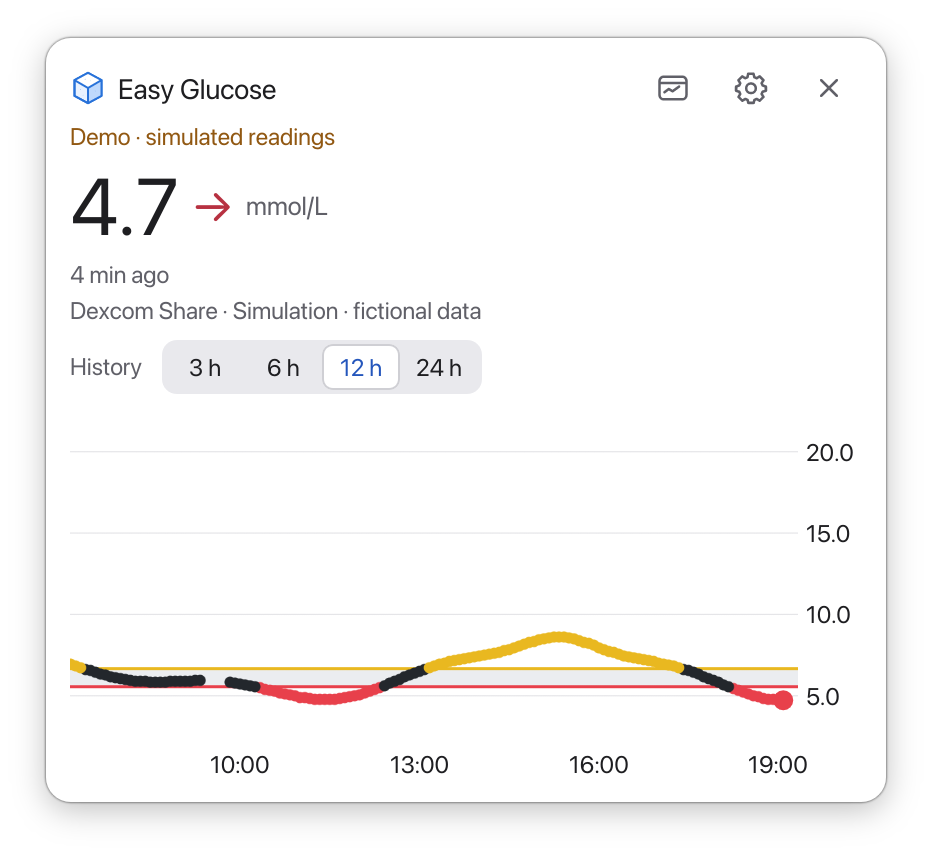

<p align="center"></p>
<h1 align="center">Easy Glucose</h1>
<p align="center">Follow your glucose in a compact desktop window, a floating widget, or the macOS menu bar.</p>
<p align="center"><a href=".github/workflows/build.yml"></a> · Rust · macOS and Windows · <a href="LICENSE">MIT License</a></p>

<p align="center"><a href="#download">Download</a> · <a href="#try-the-demo">Try the demo</a> · <a href="#three-views">Explore the views</a> · <a href="#connect-a-data-source">Connect a data source</a> · <a href="#build-from-source">Build from source</a></p>

<p align="center"></p>

## Download

Choose the download for your computer from the [latest release](https://github.com/DwennK/Easy-Glucose/releases/latest).

| Platform | Download | Open |
| --- | --- | --- |
| Mac with Apple silicon | [macOS ARM64](https://github.com/DwennK/Easy-Glucose/releases/latest/download/Easy-Glucose-aarch64-apple-darwin.zip) | Unzip and move **Easy Glucose.app** to Applications. |
| Mac with an Intel processor | [macOS Intel](https://github.com/DwennK/Easy-Glucose/releases/latest/download/Easy-Glucose-x86_64-apple-darwin.zip) | Unzip and move **Easy Glucose.app** to Applications. |
| Windows x64 installer | [Easy Glucose Setup](https://github.com/DwennK/Easy-Glucose/releases/latest/download/Easy-Glucose-Setup.exe) | Run the installer. |
| Windows x64 portable | [Windows x64](https://github.com/DwennK/Easy-Glucose/releases/latest/download/Easy-Glucose-x86_64-pc-windows-msvc.zip) | Extract the entire archive and run the app from the extracted folder. |

Starting with 1.1.0, Easy Glucose checks GitHub Releases once a day. Choose **Install and restart** when a new version appears, or check manually in **Settings → Advanced options → About**. If you are using 1.0.x, quit it and install 1.1.0 manually once. Your settings and glucose history stay in your user profile.

The macOS apps are ad hoc signed and have not been notarized by Apple. The Windows executable is unsigned.

## Try the demo

Open Easy Glucose and choose **Try the demo** on the welcome screen, or find it under **Settings → Advanced options**. The screenshots in this README use the macOS demo with example low and high guides.

To run the demo from source, install stable Rust and your platform’s build tools, then run:

```sh
git clone https://github.com/DwennK/Easy-Glucose.git
cd Easy-Glucose
cargo run --release --locked -- --demo
```

To view your own readings, open **Settings → Data sources**, choose your provider and sign in. A green checkmark confirms a successful connection. Easy Glucose shows how old each reading is. Use it as a secondary display and rely on your sensor’s official app for alarms and treatment decisions.

## Three views

| macOS menu bar preview | Floating widget |
| --- | --- |
|  |  |
| Click the glucose value to open the chart. The two buttons next to the close button open the dashboard and settings. Press Esc or click outside the preview to close it. | Drag the widget by its header. It remembers its position. Choose from three sizes and turn on **Always on top** to keep your reading visible over other windows. |

Choose **3, 6, 12, or 24 hours** in any chart. The dashboard, widget and menu bar preview share the selected period. Each dot is a sensor reading. Red dots fall below your low guide and yellow dots rise above your high guide. Gaps in the data remain visible. Hover over a chart to inspect a reading and its time.

The dashboard shows the latest value and trend arrow on the left. On the right, the change compares the last two readings when they are close enough in time. Readings at least ten minutes old are marked as stale, even when the connection is working.

On Windows, turn on **Show glucose above the clock** in Display settings or the system tray menu. The translucent widget shows the latest reading, its age, and the change since the previous reading when available. Click it to open the graph.

Right-click the macOS menu bar item or open the Windows system tray menu to access the main window, settings, and floating widget, or to quit the app.

## Connect a data source

| Source | What you need |
| --- | --- |
| **Dexcom Share** | Use the sensor wearer’s Dexcom account and select its region. Enable Share in Dexcom and add at least one follower. |
| **FreeStyle Libre · LibreLinkUp** | Use a LibreLinkUp account that has accepted a sharing invitation. If several people share data with you, choose whose readings to display. |
| **Nightscout / Nocturne** | Enter the site’s HTTPS URL. For a private site, provide a read token. Public sites work without a token. API secret authentication is also available. |

Credentials are stored in macOS Keychain or Windows Credential Manager. Easy Glucose keeps a separate local history for each source and associates it with the relevant account, person, or site. **Settings → Advanced options → Clear history** removes the active source’s local readings. Your sign-in and scheduled sync are preserved. The provider may return recent readings again on the next sync. The app does not encrypt the local readings file. The Dexcom Share and LibreLinkUp connections use unofficial protocols. [How the connectors work and their limitations (in French)](docs/sources.md)

## Languages and units

The interface uses your system language by default. You can change it on the welcome screen or under **Settings → Display → Language** without restarting. You can display readings in **mmol/L** or **mg/dL** in any language.

**20 languages** — English, Français, Deutsch, Italiano, Español, Português, Čeština, Dansk, Magyar, Nederlands, Norsk bokmål, Polski, Română, Slovenčina, Suomi, Svenska, Türkçe, Ελληνικά, Български, Українська.

## Build from source

On macOS, install the Xcode Command Line Tools. On Windows, install Visual Studio Build Tools with C++ and the Windows SDK. Python 3 is only required for packaging.

```sh
cargo fmt --check
cargo clippy --locked --all-targets -- -D warnings
cargo test --locked
cargo build --release --locked
python3 scripts/licenses.py
python3 scripts/package.py
```

On macOS, open `dist/Easy Glucose.app`. On Windows, run the two packaging scripts with `python`, then open `dist/Easy-Glucose-Windows/Easy Glucose.exe`. [Build and distribution guide (in French)](docs/distribution.md)

## Code layout

| Path | Purpose |
| --- | --- |
| [src/core.rs](src/core.rs) | Unit conversions, glucose trends, reading age, and reading selection. |
| [src/sources](src/sources) · [src/dexcom.rs](src/dexcom.rs) | Provider clients, authentication, and reading retrieval. |
| [src/services.rs](src/services.rs) · [src/storage.rs](src/storage.rs) | Background synchronization, caching, and persistence. |
| [src/ui](src/ui) · [src/platform](src/platform) | Native egui interface, floating widget, and menu bar integration. |
| [locales](locales) | One catalog per language. The build checks that every message has a translation. |

Provider tests use local servers and simulated data. [Architecture (in French)](docs/architecture.md) · [Validation (in French)](docs/validation.md) · [Third-party licenses](THIRD_PARTY.md)
