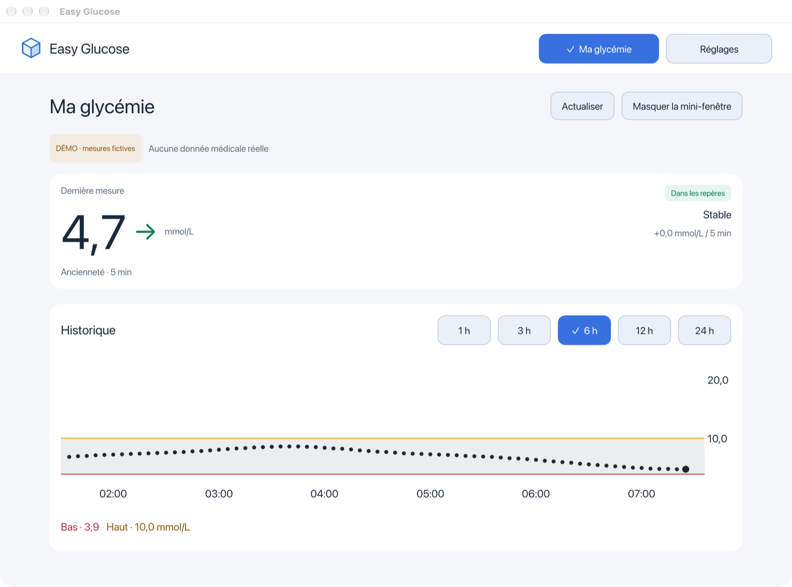
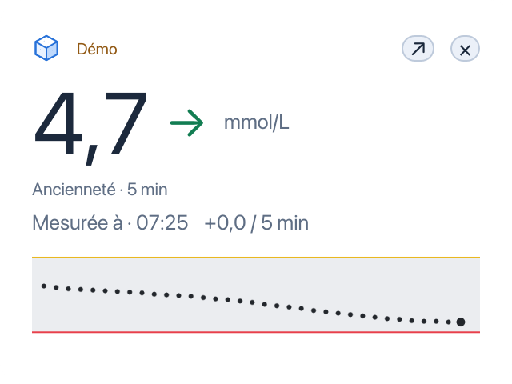

<p align="center"></p>
<h1 align="center">Easy Glucose</h1>
<p align="center">Votre glycémie dans la barre de menus, dans une mini-fenêtre ou sur un graphique de 24 heures.</p>
<p align="center"><a href=".github/workflows/build.yml"></a> · Rust · macOS et Windows · <a href="LICENSE">Licence MIT</a></p>

<p align="center"><a href="#essayer-la-démo">Essayer la démo</a> · <a href="#trois-vues">Découvrir les vues</a> · <a href="#connecter-une-source">Connecter une source</a> · <a href="#compiler">Compiler</a></p>



## Essayer la démo

Avec Rust stable et les outils de compilation de votre plateforme, lancez la démo depuis le dépôt. Elle fonctionne sans compte et utilise des mesures fictives. Les captures de ce README ont été prises dans ce mode sur macOS.

```sh
git clone https://github.com/DwennK/Easy-Glucose.git
cd Easy-Glucose
cargo run --release --locked -- --demo
```

Pour consulter votre source, lancez `cargo run --release --locked`, puis ouvrez **Réglages → Sources de données**. Chaque lecture affiche son ancienneté. Gardez l’application officielle de votre capteur pour les alarmes et les décisions de traitement. Easy Glucose sert à la consultation secondaire.

## Trois vues

| Aperçu de la barre de menus macOS | Mini-fenêtre flottante |
| --- | --- |
|  |  |
| Cliquez sur la valeur pour ouvrir le graphique. Les deux icônes près de la croix ouvrent le tableau de bord et les réglages. Échap ou un clic à l’extérieur referme l’aperçu. | Faites glisser la mini-fenêtre par son en-tête. Elle mémorise sa position. Choisissez parmi trois tailles et activez le premier plan si vous voulez garder la valeur visible. |

Dans **Ma glycémie**, choisissez une période de 1, 3, 6, 12 ou 24 heures. Chaque point correspond à une mesure reçue. Les interruptions restent visibles. Survolez le graphique pour lire la valeur et l’heure du point le plus proche. Une mesure datant d’au moins dix minutes est signalée comme ancienne, même si la connexion fonctionne.

Le clic droit sur la barre de menus macOS et le menu de la zone de notification Windows donnent accès à l’application, aux réglages, à la mini-fenêtre et à la commande pour quitter.

## Connecter une source

| Source | Données nécessaires |
| --- | --- |
| **Dexcom Share** | Compte de la personne qui porte le capteur et région du compte. Activez Share et ajoutez au moins un abonné dans Dexcom. |
| **FreeStyle Libre · LibreLinkUp** | Compte LibreLinkUp ayant accepté une invitation. Si plusieurs personnes partagent leurs données, choisissez celle dont vous souhaitez afficher les mesures. |
| **Nightscout / Nocturne** | Adresse HTTPS du site et jeton de lecture pour un site privé. Un site public fonctionne sans jeton. L’authentification par secret API est également disponible. |

Les identifiants sont conservés dans le trousseau macOS ou le gestionnaire d’identifiants Windows. L’historique local est séparé par source et associé au compte, à la personne ou au site concerné. L’application ne chiffre pas elle-même le fichier de mesures. Les connecteurs Share et LibreLinkUp utilisent des protocoles non officiels. [Fonctionnement et limites des connecteurs](docs/sources.md)

## Langues et unités

L’interface suit la langue du système. Le choix se modifie dès l’accueil ou dans **Réglages → Affichage → Langue**, sans redémarrer. Les valeurs peuvent s’afficher en **mmol/L** ou **mg/dL** indépendamment de la langue.

**20 langues** — Български, Čeština, Dansk, Deutsch, Ελληνικά, English, Español, Français, Italiano, Magyar, Nederlands, Norsk bokmål, Polski, Português, Română, Slovenčina, Suomi, Svenska, Türkçe, Українська.

## Compiler

Utilisez les outils de ligne de commande Xcode sur macOS, ou Visual Studio Build Tools avec C++ et le SDK Windows sur Windows. Python 3 sert uniquement à préparer la distribution.

```sh
cargo fmt --check
cargo clippy --locked --all-targets -- -D warnings
cargo test --locked
cargo build --release --locked
python3 scripts/licenses.py
python3 scripts/package.py
```

Le bundle macOS se trouve dans `dist/Easy Glucose.app`. Sur Windows, lancez les deux scripts avec `python` et ouvrez `dist/Easy-Glucose-Windows/Easy Glucose.exe`. La CI produit également des archives pour macOS Apple Silicon, macOS Intel et Windows x64. Les bundles macOS sont signés ad hoc. Le projet ne fournit actuellement ni notarisation Apple ni signature Windows. [Compilation et distribution](docs/distribution.md)

## Dans le code

| Chemin | Rôle |
| --- | --- |
| [src/core.rs](src/core.rs) | Conversions, tendances, ancienneté et sélection des mesures. |
| [src/sources](src/sources) · [src/dexcom.rs](src/dexcom.rs) | Clients des fournisseurs, authentification et lecture des mesures. |
| [src/services.rs](src/services.rs) · [src/storage.rs](src/storage.rs) | Synchronisation en arrière-plan, cache et persistance. |
| [src/ui](src/ui) · [src/platform](src/platform) | Interface native egui, mini-fenêtre et intégration à la barre de menus. |
| [locales](locales) | Un catalogue par langue. La compilation vérifie que chaque message est traduit. |

Les tests des fournisseurs utilisent des serveurs locaux et des données fictives. [Architecture](docs/architecture.md) · [Validation](docs/validation.md) · [Licences tierces](THIRD_PARTY.md)
